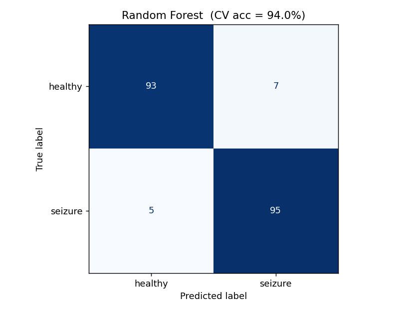

# EEG Seizure Classification

A clean Python pipeline for epileptic-seizure detection from single-channel EEG,
benchmarked on the **University of Bonn** EEG epilepsy dataset. It covers the
full workflow: EEG band decomposition, feature extraction, feature selection,
and classification with cross-validation.

The repository runs out of the box on a built-in synthetic EEG fallback, so you
can try it without downloading anything; point it at the Bonn data for the real
benchmark.

## Pipeline

1. **Band decomposition** — delta / theta / alpha / beta / gamma sub-bands via
   zero-phase Butterworth filters.
2. **Feature extraction** (per segment) — time-domain statistics (mean, std,
   variance, skewness, kurtosis, RMS, peak-to-peak), line length, zero
   crossings, **Hjorth** activity / mobility / complexity, **spectral entropy**,
   and relative band powers.
3. **Feature selection** — univariate ANOVA F-score (`SelectKBest`).
4. **Classification** — KNN, LDA, SVM (RBF), Decision Tree, Random Forest, each
   in a scaled scikit-learn pipeline.
5. **Evaluation** — stratified k-fold cross-validation with accuracy and a
   confusion matrix.

## The Bonn dataset

Andrzejak et al., *Phys. Rev. E* 64, 061907 (2001). Five sets of 100
single-channel EEG segments (4097 samples, fs = 173.61 Hz, ~23.6 s each):

| Set | Recording |
|---|---|
| Z, O | healthy volunteers (eyes open / closed) |
| N, F | interictal (seizure-free) intracranial EEG |
| S | ictal (seizure) |

The data is **not bundled** here. Set the host URL and download it:

```bash
BONN_BASE_URL="<url-hosting-the-zip-files>" python download_data.py
```

This populates `data/Z … data/S`, each a folder of `*.txt` segments.

## Install

```bash
pip install -r requirements.txt
```

## Usage

```bash
# Synthetic fallback (no data needed):
python run_classification.py

# Bonn: healthy (Z) vs seizure (S):
python run_classification.py --sets Z S

# 5-class:
python run_classification.py --sets Z O N F S
```

Example output (synthetic fallback):

```
Classifier         CV accuracy
------------------------------
Random Forest           94.00%
LDA                     92.00%
KNN                     91.50%
...
```



Use the library directly:

```python
from eeg_seizure import load_bonn, feature_matrix, evaluate, FS

X_raw, y, names = load_bonn("data", sets=("Z", "S"))
X = feature_matrix(X_raw, fs=FS)
results = evaluate(X, y, n_splits=10)
```

## Package layout

```
eeg_seizure/
  preprocess.py   band-pass filtering, EEG band decomposition
  features.py     time / frequency / Hjorth feature extraction
  datasets.py     Bonn loader + synthetic fallback
  pipeline.py     classifier pipelines + cross-validation
download_data.py  fetch the Bonn dataset into data/
run_classification.py  run the full benchmark + plot
tests/            offline pytest tests (synthetic data)
```

## Tests

```bash
pytest -q
```


